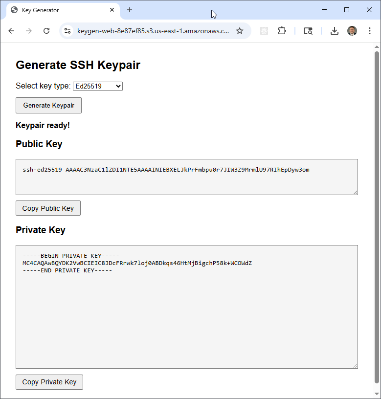

# SSH Key Generator on AWS: API Gateway, SQS, Lambda and DynamoDB

An asynchronous **SSH key pair generator** with a browser front end. A
client submits a request to an **API Gateway HTTP API**, a **Lambda**
function puts it on an **SQS** queue and returns an ID, and a
container-image worker Lambda generates the key pair and stores it in
**DynamoDB**. The client polls a second endpoint until the result is ready.
A single-page web app, served from a public **S3** bucket, does this from the
browser.



| Piece | Where | Role |
|---|---|---|
| **keygen-api** | API Gateway, us-east-1 | HTTP API, auto-deployed `$default` stage; `POST /keygen` and `GET /result/{id}`, each an `AWS_PROXY` integration; CORS allows any origin |
| **keygen-post** | Lambda | Python 3.11; sends the request to the queue and returns `202` with a request ID |
| **keygen_input** | SQS | standard queue; 60 s visibility timeout, 1 day retention, 10 s long polling |
| **sqs-keygen-processor** | Lambda | container image from ECR, 512 MB, 60 s; triggered by the queue in batches of up to 10 |
| **keygen_results** | DynamoDB | on-demand table keyed on `correlation_id`; items expire through a `ttl` attribute one day after they're written |
| **keygen-get** | Lambda | Python 3.11; returns the result, or `202` `pending` until it exists |
| **ssh-keygen** | ECR | the worker's image, tag `keygen-worker-rc1`, scanned on push |
| **keygen-web-&lt;hex&gt;** | S3 | public-read bucket holding `index.html` and `favicon.ico` |

## Architecture

<picture>
  <source media="(prefers-color-scheme: dark)" srcset="architecture-dark.svg">
  
</picture>

Regenerate with `python3 make_diagram.py`.

- **`01-sqs/`**: the queue and the ECR repository.
- **`02-docker/ssh-keygen/`**: the worker (`app.py`, using `cryptography`)
  and its `Dockerfile`, based on `public.ecr.aws/lambda/python:3.11`.
- **`03-lambdas/`**: the API, the results table, the two API functions
  (code in `code/post.py` and `code/get.py`), the worker function and its
  SQS trigger. Each function has its own role: `keygen-post` can only send
  to the queue, `keygen-get` can only read the table, and the worker can
  receive from the queue and write to the table.
- **`04-webapp/`**: the web bucket and `index.html.tmpl`, which `apply.sh`
  fills in with the API URL.

## API

There's no authentication.

| Method | Path | Body | Returns |
|---|---|---|---|
| POST | `/keygen` | `{"key_type": "rsa" \| "ed25519", "key_bits": 2048 \| 4096}`, both optional | `202` `{"request_id": "<uuid>", "status": "queued"}` |
| GET | `/result/{id}` | none | `202` `{"status": "pending", "correlation_id": ...}` until the worker finishes, then `200` with the result |

The finished result is the DynamoDB item:

```json
{
  "correlation_id": "630f70c4-815c-41d1-ae52-6babf3a41b1f",
  "status": "complete",
  "key_type": "rsa",
  "public_key_b64": "c3NoLXJzYSBBQUFBQjNOemFDMXljMkVBQUFBREFRQUJBQUFCQVFD...",
  "private_key_b64": "LS0tLS1CRUdJTiBSU0EgUFJJVkFURSBLRVktLS0tLQpNSUlFb3dJQkFBS0NBUUVB...",
  "ttl": 1767225600
}
```

Both keys are base64-encoded. Decoded, the public key is in OpenSSH format
(`ssh-rsa ...` or `ssh-ed25519 ...`) and the private key is an unencrypted
PEM: traditional RSA format for RSA, PKCS#8 for Ed25519. `key_bits` is
ignored for Ed25519, and an unknown `key_type` falls back to RSA.

```bash
curl -s https://<api-id>.execute-api.us-east-1.amazonaws.com/result/<id> \
  | jq -r .private_key_b64 | base64 -d > id_rsa && chmod 600 id_rsa
```

## Prerequisites

* [An AWS Account](https://aws.amazon.com/console/)
* [Install AWS CLI](https://docs.aws.amazon.com/cli/latest/userguide/getting-started-install.html)
* [Install Terraform](https://developer.hashicorp.com/terraform/install)
* [Install Docker](https://docs.docker.com/engine/install/) with `buildx`
* [Install jq](https://jqlang.github.io/jq/download/) and `envsubst`

If this is your first time following along, we recommend starting with this
video: [AWS + Terraform: Easy Setup](https://www.youtube.com/watch?v=9clW3VQLyxA).

## Deploy

```bash
git clone https://github.com/mamonaco1973/aws-sqs-keygen.git
cd aws-sqs-keygen
./apply.sh
```

Everything deploys to `us-east-1` in four phases:

1. **`01-sqs`** creates the queue and the ECR repository.
2. `apply.sh` logs Docker in to ECR and, **only if the tag
   `keygen-worker-rc1` isn't already there**, builds the worker image for
   `linux/amd64` and pushes it.
3. **`03-lambdas`** creates the API, the table and the three functions.
4. `apply.sh` renders `04-webapp/index.html` with the API URL using
   `envsubst`, and **`04-webapp`** uploads it.

It ends by running `validate.sh`, which submits an RSA 2048 request and
polls every 2 seconds, up to 30 times, until it's complete (set `KEY_TYPE`
and `KEY_BITS` to try others):

```
NOTE: Submitted keygen request (630f70c4-815c-41d1-ae52-6babf3a41b1f).
NOTE: Polling for result...
NOTE: Attempt 1/30: pending...
NOTE: Key generation complete.

============================================================================
KeyGen Quick Start - Validation Output
============================================================================

NOTE: Test Web URL:    https://keygen-web-<hex>.s3.us-east-1.amazonaws.com/index.html
NOTE: API Base URI:    https://<api-id>.execute-api.us-east-1.amazonaws.com
```

## Try it

1. Open the **Test Web URL**, pick a key type and size, and generate a key
   pair; the page polls for the result and shows both keys.
2. Or call the API with `curl` as above.

## Teardown

```bash
./destroy.sh
```

`destroy.sh` destroys `04-webapp` and `03-lambdas`, force-deletes the ECR
repository with its images, then destroys `01-sqs`.

## Notes

- **Lab only.** The API has no authentication and allows CORS from any
  origin, and the generated private keys sit in DynamoDB until the TTL
  removes them (DynamoDB deletes expired items within a few days, not at the
  exact time). Anyone with a request ID can fetch its private key.
- Because the image tag is fixed and step 2 skips the build when it exists,
  changes to `app.py` aren't deployed until you delete the image or the
  repository.
- If the worker fails it only logs the error; it never writes an `error`
  status, so `GET /result/{id}` keeps returning `pending`. The queue has no
  dead-letter queue, and the handler catches every exception, so a failed
  message isn't retried.
- `check_env.sh` doesn't check for `envsubst`, which `apply.sh` needs.
